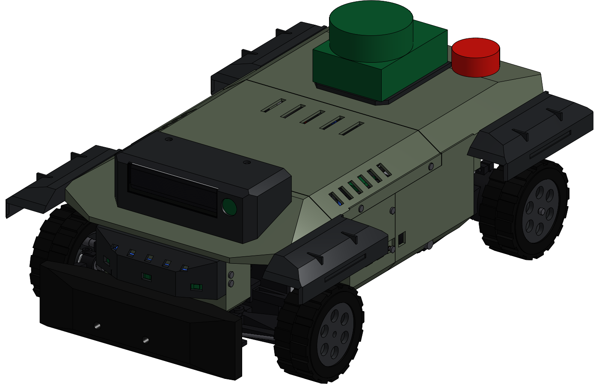
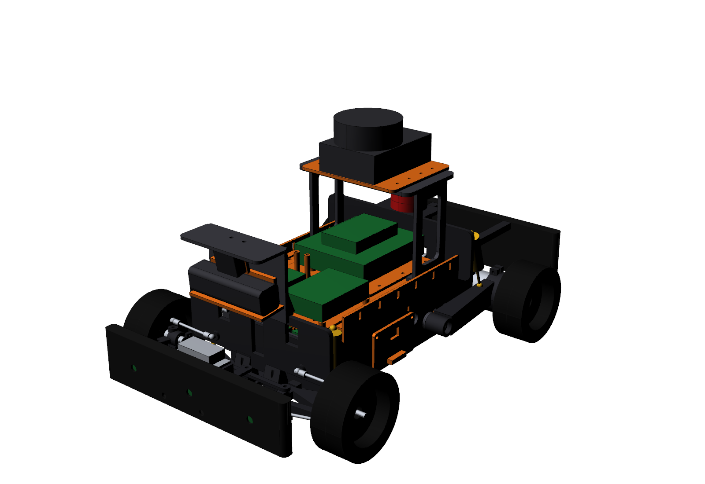

# ARV-1: Autonomous Research Vehicle (MM-SIDE)

> **T1 tactical UGV revision (2026-09-30):** the vehicle is now built natively in Onshape as a master-skeleton / derived model with an enclosed tactical body, a centre electronics hatch, a rear battery panel, a camera pod, partial fenders and a split-level nose. It has 42 printed parts, 306 part instances and 5 fully mated assemblies, with a steering linkage that animates through full lock. It was clearance-audited at full lock and at bump. STEP, STL, drawings and the BOM are in `out/t1_exports`, `out/t1_drawings` and `bom/`.
> Document: https://cad.onshape.com/documents/495cc3804c007e87f5b21cee. See [docs/13_T1_ONSHAPE_BUILD.md](docs/13_T1_ONSHAPE_BUILD.md), [bom/BOM_T1_onshape.csv](bom/BOM_T1_onshape.csv) and [cad/onshape_t1/](cad/onshape_t1/).
>
> 

A portfolio-grade, physically buildable 1/10-class autonomous ground vehicle: a custom printed
torsion-box chassis, double-wishbone front suspension with an optimised Ackermann bellcrank
steering system, independent trailing-arm rear suspension carrying two encoder gearmotors
(electronic differential), and packaged autonomy hardware (Jetson Orin Nano, RealSense D435i,
160° camera, RPLIDAR, IMU, ToF, RC override, hardware E-stop).

The takeover software package adds dependency-free, offline-tested ARV-1 safety/odometry controls
and an HCRA-6 hand-control safety seam. See `docs/12_software_bringup.md` and `docs/STATUS.md`.



| Key figure | Value |
|---|---|
| Wheelbase / track | 300 / 250 mm |
| Length × width × height | 473 × 285 × 262 mm (with LiDAR) |
| Mass | 3.62 kg with LiDAR (3.36 kg without) · CG height 76 mm · 49/51 % F/R |
| Top speed | 1.85 m/s (deliberately robotics-speed) |
| Turning radius | 0.72 m (rear-axle centre) · inner/outer lock 26.0°/19.5° · 86–102 % Ackermann |
| Suspension | 30 mm travel (+18/−12) · bump steer ≤ 0.02° · front camber −1.4° at full bump |
| Odometry | 1216 counts/wheel-rev on each rear wheel (0.22 mm/count) + optional front AS5600 |
| Runtime | ≈ 57 min mixed (3S 5000 mAh) |
| Printed parts | 35 designs / 46 pieces, all fit a 256³ bed; PA-CF, PETG-CF, PETG, TPU |
| Approx. cost | ≈ $1,480 all-in (≈ $700 is Jetson + D435i + LiDAR) |

## Repository map

| Path | Content |
|---|---|
| `cad/master/car_master.py` | **00_CAR_MASTER**: the single source of truth (123 master variables, purchased-part data) |
| `cad/onshape/CAR_MASTER.fs` | Generated Onshape FeatureScript: master variables + SK00–SK14 master sketches |
| `cad/onshape/onshape_api_build.py` | Script that builds the Onshape document through the API (needs network + keys) |
| `cad/parts/*.py` | Part Studios (chassis, front, rear, electronics, sensors, protection, purchased envelopes) |
| `cad/build.py` | Assemblies, STEP/STL export, interference + motion sweep |
| `cad/drawings.py`, `cad/render.py` | Drawing package, renders |
| `analysis/front_kinematics.py` | Suspension + steering kinematics and optimiser (Ackermann, bump steer, camber) |
| `analysis/vehicle_calcs.py` | Mass/CG, drivetrain, steering torque, springs/shocks, loads, power (writes docs/04) |
| `bom/` | BOM.csv, print_list.csv, purchase_list.csv (+ generator) |
| `out/step/` | `ASM_CAR_COMPLETE.step` + sub-assemblies + per-part STEP (AP214) |
| `out/stl/` | Print-oriented STLs |
| `out/renders/` | Iso, exploded, chassis layout, sensor layout, full-lock motion views |
| `docs/` | 01 requirements → 11 MM FORGE export, drawings |

## Documents

1. [Vehicle requirements](docs/01_vehicle_requirements.md)
2. [Custom vs commercial architecture study](docs/02_architecture_study.md)
3. [Final architecture](docs/03_final_architecture.md)
4. [Engineering calculations (generated)](docs/04_engineering_calculations.md)
5. [Component selection](docs/05_component_selection.md)
6. [Onshape build guide](docs/06_onshape_build_guide.md)
7. [Print guide](docs/07_print_guide.md)
8. [Build sequence](docs/08_assembly_sequence.md)
9. [Electrical and software readiness](docs/09_electrical_and_software_readiness.md)
10. [Validation report and audit](docs/10_validation_report.md)
11. [MM FORGE export](docs/11_mm_forge_export.md)
12. [Drawing package](docs/drawings/DRAWINGS.md)

## Regenerate everything

```bash
pip install cadquery scipy                       # CadQuery 2.8 (OCCT 7.9)
python3 analysis/front_kinematics.py             # verify steering/suspension (add --optimise to re-solve)
python3 cad/build.py --check                     # parts, assemblies, STEP/STL, interference + motion
python3 analysis/vehicle_calcs.py                # calculations (uses CAD volumes)
python3 bom/generate_bom.py                      # BOM, print list, purchase list
python3 cad/drawings.py                          # drawings
python3 cad/onshape/generate_featurescript.py    # Onshape master FeatureScript
xvfb-run -a python3 cad/render.py                # renders
```

Change a number in `car_master.py` and rerun: parts, assemblies, analyses, drawings, BOM and the
Onshape FeatureScript all follow.
