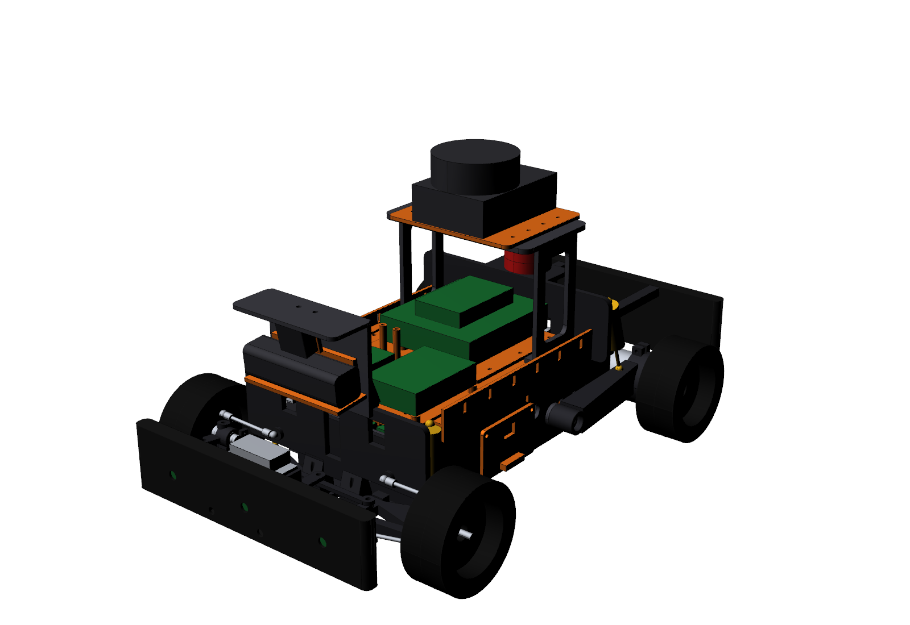

# 03 — Final Vehicle Architecture (PHASE 3)

## 3.1 Layout (vehicle frame: X forward, Y left, Z up; origin = ground, centreline, mid-wheelbase)

| Zone | X range (mm) | Contents |
|---|---|---|
| Nose | +200 … +235 | TPU crush bumper with 3 ToF pockets, bolted to the servo pillars |
| Front bulkhead | +115 … +219 | Lower-arm hinge blocks, bellcrank posts, inverted steering servo, shock-tower pads |
| Front axle | +150 | Ball-joint knuckles, 2× 685ZZ each, M5 rotating axle, AS5600 encoder interface |
| Front shock tower + sensor mast | +127 … +192 | Vertical shocks (Y ±80), camber links, mast carrying D435i + 160° camera + visor |
| Tub, front bay | +58 … +112 | Fuse block, servo BEC, 5 V buck (power tray 73) |
| Battery tunnel | +5 … +55 | Transverse 3S 5000 mAh LiPo, side-loading, doors both sides |
| Tub, rear bay | −112 … +2 | Motor driver (71), 19 V DC-DC (72), rear-arm pivot bosses |
| Upper deck (Z 92–96) | −76 … +132 | 20 mm M3 insert grid: Jetson tray (70), Teensy/IMU/receiver plate (74), LiDAR mast (84) |
| Rear shock tower | −83 … −78 (plate) | Rear shock tops, E-stop shelf, bumper hoop over the motors |
| Rear axle | −150 | Trailing arms with face-mounted 37D gearmotors, hex adapters |
| Tail | −238 … −226 | TPU rear bumper with rear ToF pocket |

## 3.2 Structure and load paths

- **Torsion box**: skid + tub floor + 55 mm walls + two transverse battery-tunnel walls form the lower
  shell. Two 10×10×1 aluminium longerons clamp onto the wall tops at 6 stations, and the deck bolts
  through the longerons at 8 points to close the box.
- **Front**: wheel load goes through the knuckle, the lower ball and the printed A-arm into the Ø3
  hinge pin and bulkhead blocks, then through the bulkhead floor and flange into the tub front wall
  (6× M3). Shock load goes through the arm tab and shock into the tower on 4× M3 into the bulkhead
  pads.
- **Rear**: wheel load goes through the gearmotor face (6× M3 plus the cup pinch clamp) into the
  trailing arm. From there it passes through the 686ZZ pivot and Ø6 shoulder bolt into an M5 insert
  in a gusseted tub boss; the shock carries it up into the rear tower and then into the rails. Motor
  torque reacts inside the arm.
- **Battery**: sits low (CG Z ≈ 49 mm) between the tunnel walls. Doors carry only retention loads.

## 3.3 Subsystems

| Subsystem | Architecture |
|---|---|
| Front suspension | Double wishbone, lower A-arm 79 mm, camber link 57 mm, caster 5°, scrub 12 mm, 30 mm travel (+18/−12), MR 0.57 |
| Rear suspension | Trailing arm 118 mm, 2× 686ZZ pivot, MR 0.70, zero camber and track change |
| Steering | Dual bellcrank + parallelogram drag link + servo link; 26° inner / 19.5° outer lock; 86–102 % Ackermann; bump steer ≤ 0.02° |
| Drivetrain | 2× Pololu 37D 19:1 with 64 CPR encoders, direct drive, electronic differential; 1.85 m/s top speed |
| Power | 3S LiPo → XT60 pigtail → 15 A main fuse → branches: motor (10 A fuse, through E-stop NC contact + watchdog relay) / compute 19 V buck-boost (5 A fuse) / 5 V 5 A logic / 6 V 5 A servo BEC |
| Compute | Jetson Orin Nano Super (vision, SLAM, planning) + Teensy 4.1 (1 kHz motor PID, encoders, SBUS RC, E-stop watchdog, ToF + IMU hub) |
| Sensors | D435i (depth + IMU) at Z 140, 160° IMX219 at Z 168, RPLIDAR A1 scan plane Z 238, BNO085 IMU on a solid plinth, 4× VL53L1X in bumpers, rear-wheel encoders, optional front AS5600 |
| Protection | TPU crush bumpers front/rear, sacrificial skid, deck side skirts, visor over the front sensors, rear hoop over the motors |

## 3.4 Safety and manual-override architecture (mechanical provision)

1. **Hardware E-stop** (22 mm latching mushroom, NC). It sits on the rear tower top, reachable
   from any side, and breaks the motor-driver supply. Compute stays alive for logging.
2. **Wireless E-stop**: an RC switch channel is read by the Teensy, which drops the watchdog relay
   in series with the motor branch.
3. **Watchdog**: if the Jetson heartbeat stops for 200 ms the Teensy brakes to zero and opens the
   relay.
4. **Manual override**: the SBUS receiver feeds the Teensy directly (not the Jetson). An RC mode
   switch selects MANUAL / AUTO, and MANUAL always wins.
