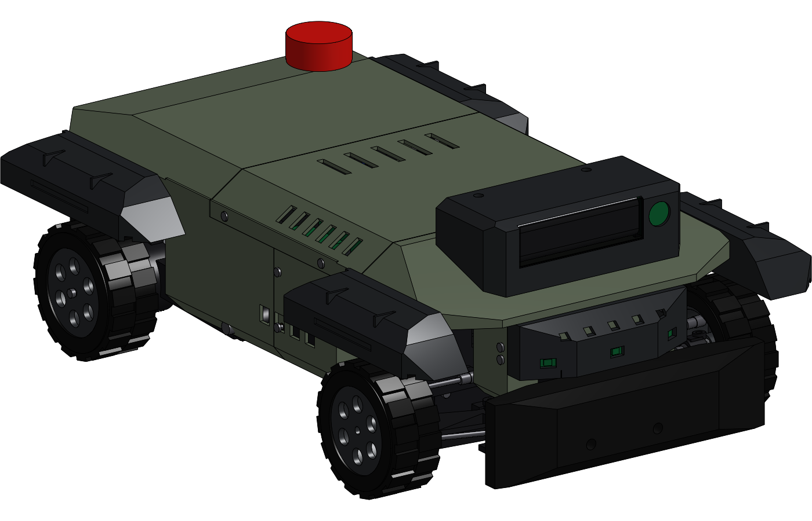

# 13 — ARV-1 T1 "Tactical UGV" — Onshape build (as built)

This document records what actually exists in Onshape as of 2026-09-30.
It replaces the plan in `06_onshape_build_guide.md` for the T1 revision.
Everything below was built, regenerated and checked in Onshape.



## 1. Onshape document

| Item | Value |
|---|---|
| Document | **SIDE ARV-1 Autonomous RC Car** — `https://cad.onshape.com/documents/495cc3804c007e87f5b21cee` |
| Workspace | Main `d35a802f9506c7c27b1f7854` |
| Versions | `V1 all studios regenerate` → `V2 audit clean` → **`V3 T1 complete`** |
| Library | Feature Studio `01_FS_ARV_LIB` (≈175 k chars). Local source is `cad/onshape_t1/src/*.fs`, built by `tools/build.js` into `ARV_LIB.fs`. |

## 2. Master-skeleton / derived architecture

```
00_CAR_MASTER   26 native #variables  +  6 "ARV Master Layer" features
      │   (every master sketch body carries {arvMaster: layer, P: parameter map})
      ├── Derived ──► 10_CHASSIS           (SK01, SK02, SK04)
      ├── Derived ──► 20_FRONT_STEERING    (SK01, SK02, SK03)
      ├── Derived ──► 30_DRIVETRAIN        (SK01, SK02)
      ├── Derived ──► 40_BATTERY_SYSTEM    (SK02, SK04)
      ├── Derived ──► 50_ELECTRONICS_TRAY  (SK01, SK04)
      ├── Derived ──► 99_AUDIT_* (3)       (SK01–SK04)
      └── Derived ──► 60_BODY_MASTER       (SK02, SK03, SK05) + 4 "ARV Body Master" layers
                          └── Derived ──► 61_FRONT_FASCIA_BUMPERS, 62_BODY_MAIN,
                                          63_CENTER_SERVICE_PANEL, 64_REAR_BATTERY_PANEL,
                                          65_CAMERA_POD, 66_FENDERS   (BK01–BK03)
```

- Every subsystem studio starts with a **native Onshape Derived feature**. It pulls only the master sketches that studio needs.
- The studio's `ARV Studio Builder` feature then reads the master parameter map from the derived geometry. It errors out if the Derived feature is missing.
- No shared dimension is re-typed in any subsystem studio.
- Local detail stays local: ribs, fillets, insert pockets, counterbores, clip slots.

### Master variables (native, `00_CAR_MASTER`)

- **Chassis and wheels:** `#wheelbase 300`, `#trackWidth 250`, `#wheelDiameter 85`, `#wheelWidth 35`, `#groundClearance 25`, `#chassisLength 230`, `#chassisWidth 152`.
- **Body:** `#bodyWidth 224`, `#bodyHeight 142`, `#bodyLength 420`, `#noseX 205`, `#shoulderZ 126`, `#roofWidth 176`, `#fenderClearance 8`, `#fenderWidth 152`.
- **Battery:** `#batteryLength 139`, `#batteryWidth 47`, `#batteryHeight 37`, `#batteryFrontX -54`.
- **Tray and sensors:** `#trayDeckZ 84`, `#cameraX 170`, `#cameraHeight 152`, `#cameraTilt 5°`, `#frontSensorZ 86`, `#frontSensorSplay 25°`, `#steerLockInner 26°`.

### Master sketches / references

| Layer | Content |
|---|---|
| SK01_TOP_LAYOUT | Centreline, axles, wheel centres, tyre footprints, front-wheel sweep circles, kingpins, tub, bulkhead, body envelope, pods, bumper, electronics region, battery region, camera point, 3 front + 1 rear ToF points |
| SK02_SIDE_PROFILE | Ground, tyres (static and full bump), axle line, clearance line, tub, electronics envelope, battery, hull / pod / camera-pod / bumper / fascia profiles, shoulder line, hatch lines, battery-panel line |
| SK03_FRONT_TRACK | Tyres, kingpin axes, upper and lower ball points, A-arm and camber-link lines, fender sections, chassis width, body section, nose section, fascia width, ground-clearance line |
| SK04_INTERNAL_PACKAGING | Real component envelopes: MDD10A, 19 V DC-DC, fuse block, 5 V buck, 6 V BEC, Jetson Orin Nano, Teensy carrier, BNO085, receiver, battery, relay, D435i, servo, IMX219, E-stop, battery tunnel, tray deck |
| SK05_BODY_SERVICE | Shell plan, centre-hatch opening, battery-panel opening, fascia, camera pod, 4 fender boundaries, 6 shell/chassis mount points |
| REF_DATUMS | Datum planes and interface connectors (see below) |

- **Planes (6):** `PL_FRONT_AXLE`, `PL_REAR_AXLE`, `PL_AXLE_HEIGHT`, `PL_TUB_TOP`, `PL_TRAY_DECK`, `PL_SHOULDER`.
- **Interface mate connectors (8):** 4 wheel centres, 2 caster-tilted steering axes, chassis origin, camera.

### Parametric validation (performed)

I changed `#wheelbase` from 300 to 330 mm in `00_CAR_MASTER` and measured the Part Studio bounding boxes:

| Studio | 300 mm (X extent) | 330 mm (X extent) |
|---|---|---|
| 20_FRONT_STEERING | 107 … 219 | **107 … 234** (+15, the front axle moved) |
| 30_DRIVETRAIN | −192.7 … −22 | **−207.7 … −37** (−15, the rear axle moved) |
| 66_FENDERS | ±226.5 | **±241.5** (fenders follow the wheels) |
| 10_CHASSIS / 62_BODY_MAIN | unchanged extents | unchanged extents (driven by `#chassisLength`, `#noseX`, `#bodyLength`) |

Reverting to 300 mm restored every studio exactly.
The side pods, shock-tower positions and body mount points also move inside the body, because they are defined from the axle positions.

## 3. Part Studios and physical parts (35 printed designs, 272 part instances)

| Studio | Printed parts (part number) | Purchased / hardware in the studio |
|---|---|---|
| 10_CHASSIS | MAIN_CHASSIS (10-001), LOWER_SKID (10-002), REAR_SHOCK_TOWER_L/R (10-003/004), REAR_BUMPER_FRAME (10-005) | inserts, skid screws, frame screws |
| 20_FRONT_STEERING | FRONT_BULKHEAD with integral servo cradle (20-001), FRONT_SHOCK_TOWER (20-002), FRONT_KNUCKLE_L/R (20-003/004), FRONT_LOWER_ARM_L/R (20-005/006), BELLCRANK_L/R (20-007/008), DRAG_LINK (20-009), SERVO_LINK (20-010) | 20 kg servo, 25T horn, tie rods, camber links, front shocks, M5 axles, 685ZZ ×4, 12 mm hex with 3.3 mm spacer, front tyres and rims |
| 30_DRIVETRAIN | TRAILING_ARM_L/R with motor cups (30-001/002), HEX_ADAPTER_L/R (30-003/004) | Pololu 37D 19:1 ×2, Pololu hubs, rear shocks, 686ZZ ×4, ISO 7379 pivots, rear tyres and rims |
| 40_BATTERY_SYSTEM | BATTERY_TUNNEL (40-001) | 3S 5000 battery, XT60 pair, foam stop |
| 50_ELECTRONICS_TRAY | TRAY_FRAME (50-001), TRAY_UPPER_DECK with IMU plinth (50-002) | Jetson Orin Nano Super, Teensy 4.1 carrier, MDD10A, 19 V DC-DC, 5 V buck, 6 V BEC, fuse block, SBUS receiver, BNO085, watchdog relay |
| 61_FRONT_FASCIA_BUMPERS | FRONT_SENSOR_FASCIA (61-001), FRONT_BUMPER TPU (61-002), REAR_BUMPER TPU (61-003) | VL53L1X ×4 (3 front, 1 rear) |
| 62_BODY_MAIN | BODY_MAIN_FRONT (62-001), BODY_MAIN_REAR (62-002) | E-stop 22 mm, inserts, screws |
| 63_CENTER_SERVICE_PANEL | CENTER_SERVICE_PANEL (63-001) | 4 × M3 button head |
| 64_REAR_BATTERY_PANEL | REAR_BATTERY_PANEL (64-001) | 2 × M3 thumb screws |
| 65_CAMERA_POD | CAMERA_POD (65-001), CAMERA_WINDOW (65-002) | D435i, IMX219 160° |
| 66_FENDERS | FENDER_FL/FR/RL/RR (66-001…004) | 8 × M3 button head |

- Every part is a single named solid with a part number, material, description and appearance.
- Each description ends with `[LNK_<link> #n]`, which identifies the kinematic link and a stable serial.
- Hardware is modelled as real parts: 78 heat-set inserts and 115 screws.

**Print bed:** every one of the 35 printed designs fits 256 × 256 × 256 (largest is BODY_MAIN_REAR at 245 × 224 × 100).
The body shell is therefore split into front and rear halves. They join under the centre hatch with bolted splice plates (4 × M3), so the split line is hidden when the vehicle is closed.

## 4. Body system

| Element | Status | Engineering |
|---|---|---|
| Main shell | Built (2 printed halves) | Hard-surface three-view hull with chamfered roof and shoulders. Armoured side pods between the wheels hide the tub, pivots and arm roots; they open inboard below the tub top. The nose box hides the servo top and bulkhead. The tail box houses the battery tunnel. The hull underside over each wheel well is closed, with 8 mm clearance to the tyre at full bump. |
| Centre electronics service panel | Built | Roof, chamfers and 10 mm side walls. The opening X −48…112 passes the whole electronics tray. Two locating lips per side; 4 × M3 button heads go into inserts in tabs on the main body. End ledges sit outside the tray footprint. Jetson exhaust slots are on both chamfers, plus a rear vent strip. |
| Rear battery service panel | Built | Tail panel with 2 locating tabs that bear on the tunnel bay. A push-stop holds the battery forward; a grip bar; 2 × M3 thumb screws go into inserts in the tunnel mouth. |
| Structural lower bumper | Built | TPU 95A crush cells. 2 × M3 × 16 with washers into the bulkhead servo-pillar inserts. It protects the steering and fascia. |
| Upper sensor fascia | Built | Faceted nose sitting above the bumper (split-level nose). Three recessed VL53L1X apertures: centre, plus two corners splayed 25°. Boards load from the rear into pockets with M2 retainers. Side tongues take 4 × M3 screws from the wheel wells. The floor is opened over the inverted servo. |
| Low-profile camera pod | Built | Roof-conforming base, D435i on a 2 × M3 rear-face bracket, IMX219 lens port, protective window. 2 × M3 × 30 go from the top into roof inserts. The cable exits through a Ø18 roof pass-through. |
| Partial tactical fenders | Built (4) | Angular eyebrows that frame the tyre top and leave the tyre exposed around the outer and lower side. Inner flange with 2 × M3 into hull-side inserts; screws are reached from the wheel well. Recess for a light strip. |
| Body ↔ chassis | Built | 6 tabs onto tub flange inserts (X −20 / 40 / 80). 2 tail screws into the tunnel flange. 2 nose locating pins into the front shock-tower top. |
| Passive cooling | Built | Pod louvres sit above the tub vent slots (no line of sight to the PCBs). Tub side vents. Tray airflow slots under the Jetson. Hatch chamfer and rear exhaust vents. |

## 5. Internal packaging (final)

| Item | Location |
|---|---|
| Battery (3S 5000 hard case) | Rear, **above the gearmotors** in `BATTERY_TUNNEL` (X −193…−54, Z 86…123). Removed rearward through the rear panel. XT60 bay at the tunnel mouth; the pigtail runs forward in the roof channel. |
| Jetson Orin Nano Super | Tray upper deck, front (X 6…109), 6 mm stand-offs, under the hatch vents |
| Teensy 4.1 carrier, SBUS receiver, BNO085 | Tray upper deck, rear. The IMU sits on a rigid plinth near the CG (X −20…5, Y +46), X forward / Z up. |
| MDD10A, 19 V DC-DC, 5 V buck, 6 V BEC, fuse block | Tray lower level inside the tub. Power on −Y, logic power on +Y, cable corridor on the centreline. |
| Watchdog relay | Rear tub bay on floor bosses |
| Steering servo | Inverted in the bulkhead cradle, under the fascia |
| D435i + IMX219 | Camera pod (optical centre Z 152) |
| ToF | 3 in the fascia, 1 in the rear bumper |
| E-stop | Rear deck (X −175, Y +58). It stays exposed for safety. |
| Wiring | Tub side-wall pass-throughs for the motor leads, a front-wall corridor for servo / ToF / camera, a tunnel roof channel for the XT60 pigtail, deck pass-throughs (power right, signal left, camera front), tie-down loops on the tray corridor, and cable-tie slot pairs on the deck edges |

**Change from ARV-1:** the transverse side-loading battery tunnel and the LiDAR / sensor mast were replaced.
The new brief requires a fully enclosed body, a rear battery panel and a low camera pod.
The RPLIDAR (optional in ARV-1) is **not** in T1.

## 6. Assemblies

| Assembly | Instances | Mates (all OK) |
|---|---|---|
| **ASM_RC_CAR_COMPLETE** | 272 | 277 |
| ASM_FRONT_STEERING | 58 | 63 |
| ASM_DRIVETRAIN | 42 | 41 |
| ASM_CHASSIS (chassis + battery + electronics) | 96 | 95 |
| ASM_BODY | 76 | 75 |

**How the mates are built:**
- Every part carries part-owned mate connectors (feature `ARV Link Connectors` in each studio).
- Parts inside a kinematic link are Fastened to the link's primary part.
- Links are joined by:
  - **Revolute:** servo horn, bellcranks, drag link, servo link, both kingpins (caster-tilted axis) and all 4 wheels.
  - **Ball:** both ends of each tie rod and each camber link.
  - **Slider:** battery in its tunnel, limit −165…0 mm (the removal stroke).
- The servo revolute is limited to ±29°.
- The front A-arms and rear trailing arms are **fastened at ride height**. Suspension travel is covered by the ARV-1 kinematic analysis, not by assembly motion.

## 7. Tests performed (FeatureScript `ARV Clearance Audit`)

Each of these studios rebuilds the complete vehicle from the master and runs `evCollision`:

| Test | Result |
|---|---|
| Straight-ahead: moving corner vs everything | **0 clashes** |
| **Full left lock** (crank +31°): inner 26.0° / outer 19.5° | **0 clashes** (tyres vs fenders, body, bumper, chassis, linkage) |
| **Full right lock** (crank −31°): inner 26.0° / outer 19.5° | **0 clashes** |
| Battery removal sweep (battery section extruded rearward past the tail, panel off) | **PASS**, no obstruction |
| Electronics service: tray lift sweep through the hatch opening (hatch off) | **PASS**, no obstruction |
| Static clashes between links (hardware excluded) | 0 with volume. Two zero-volume face contacts remain by design: the hatch seated on the body walls, and a shock ball end touching its stud boss. |

**Audit history:** round 1 found 36 clashes, round 2 found 16, and the final model has 0.
Fixes along the way:
- Pods were split into left and right with an open centre bay, removing walls that had crossed the tub.
- The rear frame cross bar was lowered out of the battery exit path.
- The fascia was raised above the servo pillars.
- The knuckle arm root was reworked, and the hex and rim hub moved 3.5 mm outboard.
- The trailing-arm beam top was lowered under the shock ball.
- The tray plate was trimmed around the bulkhead bosses.

The steering values match ARV-1's solved Ackermann (26.0° / 19.5°), because the linkage is solved on the same geometry.

## 8. Manufacturing notes / open issues

- **Purchased envelopes:** the ARV-1 `VERIFY` items remain open: MDD10A, Jetson and DC-DC hole patterns (slotted stand-offs), 37D face thread depth, shock stroke, rim ID. Measure the real parts before printing the parts that use them.
- **Body halves:** print nose-down / tail-down with tree supports under the hull floor over the wheel wells. The ASA walls are 2.4 mm.
- **Fender screws** are reached from the wheel well with a ball-end hex key.
- **Assembly motion:** the linkage mates are complete and error-free. Setting mate values through the REST API did not move the linkage, so interactive drag-testing of the steering in `ASM_RC_CAR_COMPLETE` has **not** been done. The full-lock kinematics and clearances are proven in the audit studios.
- **Suspension:** arms are fastened in the assemblies. Bump clearance is designed in (hull underside = tyre top at full bump + 8 mm), but a combined bump + lock audit was not run.
- **Not produced for T1:** 2D drawings, STEP/STL exports, and wiring harness geometry (only the routes and mounts are modelled).

## 9. DONE IN ONSHAPE vs NOT YET MODELED / REMAINING

**Done in Onshape**
- `00_CAR_MASTER`: variables, SK01–SK05, datums and connectors
- Native Derived features in 15 studios
- `60_BODY_MASTER` derived layer
- 35 printed part designs and all purchased envelopes, with inserts and screws
- Split structural chassis (tub + bulkhead, bolted), front steering, drivetrain, battery tunnel with retention and rear removal, two-level removable electronics tray
- Enclosed tactical body: split-level nose with structural bumper and sensor fascia, camera pod, 4 partial fenders, centre hatch, rear battery panel, body ↔ chassis fastening, passive vents
- 5 assemblies, fully mated
- Audit studios: centre, full left, full right
- Parametric propagation test
- Versions V1–V3

**Not yet modeled / remaining**
- Drawings, STEP/STL export
- Wire harness geometry
- Suspension travel in the assemblies, and a bump + lock combined audit
- Interactive steering drag in the assembly
- LiDAR provision
- Verification of the vendor-dimension `VERIFY` items against real parts
