# ARV-1 Drawing Package

_Generated by `cad/drawings.py` from CAR_MASTER. Dimensions in mm, vehicle frame (X fwd, Y left, Z up)._

## General fits and tolerances

| Feature | Specification | Parts |
|---|---|---|
| Bearing seat 685ZZ (Ø11) | Ø11.10 printed, ream to Ø11.00 +0.02/-0.00 for light press | knuckles |
| Bearing seat 686ZZ (Ø13) | Ø13.10 printed, ream to Ø13.00 +0.02/-0.00 | rear trailing arms |
| Bearing seat MR84ZZ (Ø8) | Ø8.10 printed, ream to Ø8.00 +0.02/-0.00 | bellcranks |
| Hinge pin Ø3 | Ø3.0 in bulkhead blocks (tight: drill 3.0 after print), Ø3.2 in arm tube (running) | front lower arms |
| Shoulder pivots Ø4 | Ø4.05 +0.05/-0.00 (drill 4.0, ream 4.05) | drag link, servo link |
| M3 clearance | Ø3.4 | all |
| M3 heat-set insert pocket | Ø4.0 x 6.0 deep (insert OD 4.6–4.7 x 5.7) | all |
| M5 heat-set insert pocket | Ø6.4 x 9.5 deep | tub rear-arm pivots |
| Gearbox bore 37D | Ø37.4 (slip) + pinch bolt; spigot Ø12.4 | rear trailing arms |
| Default printed tolerance | ±0.2 mm on features ≤ 50 mm, ±0.4 mm > 50 mm; flatness of mating faces 0.3 mm | all |

## DWG-21 — 21/22_FRONT_KNUCKLE (L shown, R mirrored)

Material: **PA-CF**. Print data: see `bom/print_list.csv`. STEP: `out/step/parts/`.

| Top | Front | Side | Iso |
|---|---|---|---|
| 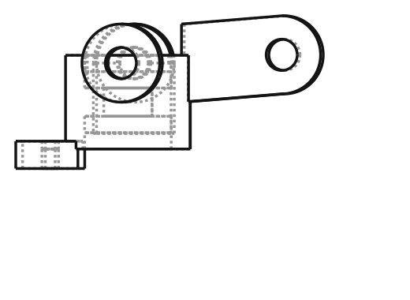 | 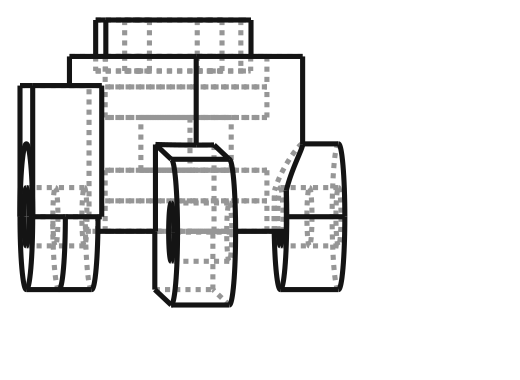 | 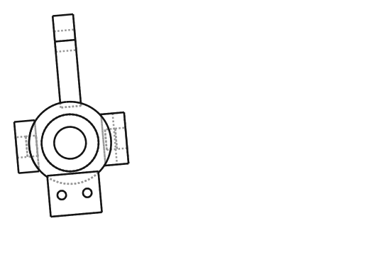 | 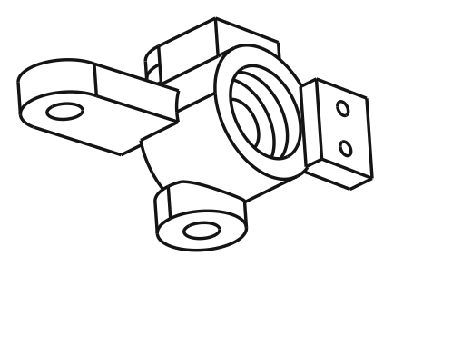 |

| Feature | Dimension |
|---|---|
| Bearing housing | Ø16 x 12 (Y 102–114), 2x 685ZZ seats, Ø6.2 through |
| Kingpin line (ball centres) | Y 113.0; lower Z 26.5, upper Z 60.0; caster 5.0° |
| Lower ball stud boss | Ø10, face 5.0 above ball; M3x4 short insert |
| Upper ball stud boss | Ø10 x 4 (Z 49–53), face 7.0 below ball; M3x4 short insert |
| Steering arm | length 20.0 mm @ 3.03° outboard; ball hangs to Z 36.5; M3x4 insert |
| Encoder tab | 2x Ø3.4 (M2 self-tap), 5 mm apart, 10 mm behind axle |

Notes:
- Axle: M5x35 DIN 912 rotating in bearings; bolt head inboard carries the AS5600 magnet cap.
- Scrub radius 12 mm; KPI 0°; caster built into part (rotated 5° about axle centre).

## DWG-23 — 23_FRONT_LOWER_ARM (L shown)

Material: **PA-CF**. Print data: see `bom/print_list.csv`. STEP: `out/step/parts/`.

| Top | Front | Side | Iso |
|---|---|---|---|
| 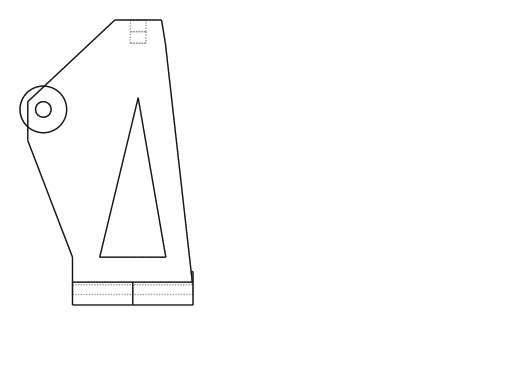 |  | 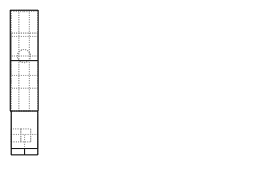 | 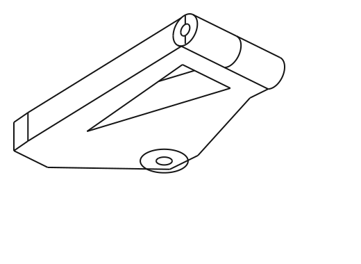 |

| Feature | Dimension |
|---|---|
| Hinge axis | Y 34.0, Z 26.5; tube Ø8.6, Ø3.2 bore, length 31 between blocks |
| Arm length (hinge → ball) | 79.0 mm |
| Ball-end insert | M3 insert along Y at ball Y − 10 (ball end + jam nut) |
| Shock mount | M3 insert at X 127.0, Y 80.0, ball Z 33.5 |
| Plate | Z 22.3–30.5 (8.2 thick) |

Notes:
- Print flat; hinge bore drilled Ø3.2 through after printing to stay coaxial.

## DWG-31 — 31_REAR_TRAILING_ARM (L shown)

Material: **PA-CF**. Print data: see `bom/print_list.csv`. STEP: `out/step/parts/`.

| Top | Front | Side | Iso |
|---|---|---|---|
| 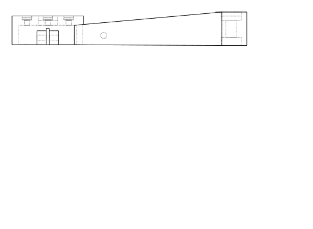 | 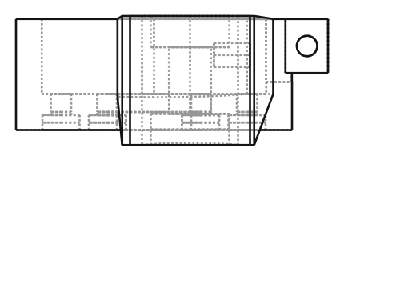 |  | 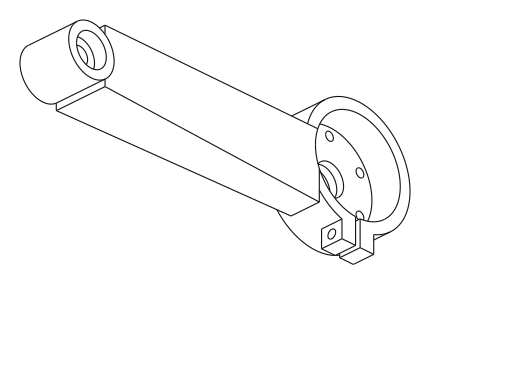 |

| Feature | Dimension |
|---|---|
| Pivot | X -32.0, Z 48.5; boss Ø20 x 21.5; 2x 686ZZ seats Ø13.1 x 5.2 |
| Arm length pivot → axle | 118.2 mm |
| Motor cup | gearbox bore Ø37.4, face plate 6 mm, spigot Ø12.4, 6x Ø3.4 on Ø31 PCD @30°+60°n, c'bore Ø6.2 x 2.5 |
| Shock mount | M3 insert, ball at X -114.0, Z 62.5, Y 86.0 |
| Pinch clamp | slit 2 mm, M3x16 + nyloc |

Notes:
- Pivot bolt: ISO 7379 Ø6x25 (M5) into tub M5 insert; 1.5 mm washer under head, 2 mm thrust washer at chassis.

## DWG-32 — 32_REAR_HEX_ADAPTER

Material: **PA-CF**. Print data: see `bom/print_list.csv`. STEP: `out/step/parts/`.

| Top | Front | Side | Iso |
|---|---|---|---|
| 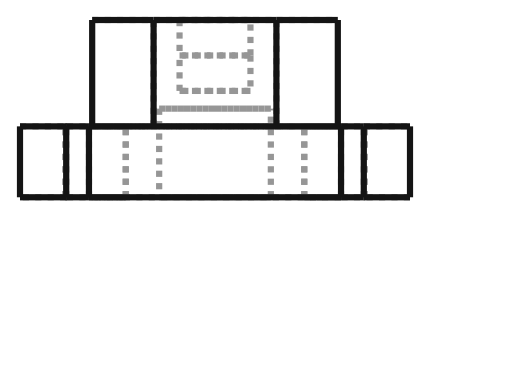 | 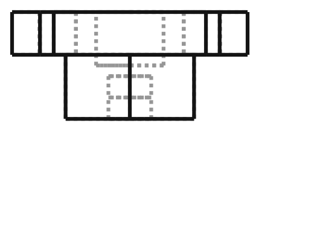 |  |  |

| Feature | Dimension |
|---|---|
| Flange | Ø22 x 4, 4x Ø3.4 on Ø19.05 PCD @45° (Pololu #1999, VERIFY) |
| Hex | 12.0 A/F x 6 |
| Shaft relief | Ø6.3 x 5 |
| Wheel screw | M3x4 short insert on axis |

## DWG-42 — 42_BELLCRANK (L shown)

Material: **PA-CF**. Print data: see `bom/print_list.csv`. STEP: `out/step/parts/`.

| Top | Front | Side | Iso |
|---|---|---|---|
| 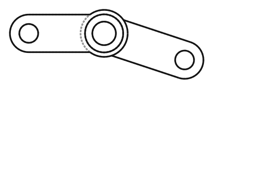 | 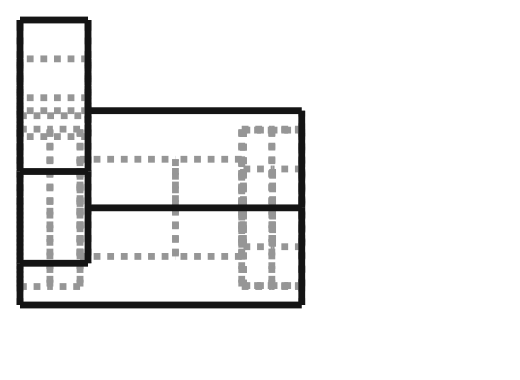 | 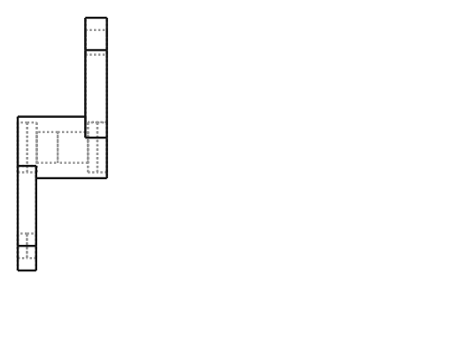 | 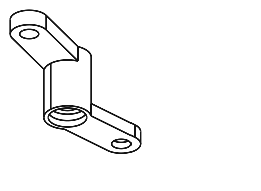 |

| Feature | Dimension |
|---|---|
| Pivot | X 176.0, Y ±48.9, 2x MR84ZZ, ISO 7379 Ø4x12 |
| Tie-rod arm | R 18.0 @ -18.35° (left), ball Z 36.5 |
| Drag arm | R 16.0 @ 180° (both cranks, parallelogram), Z 40–43 |
| Crank travel | ±31.0° for 26° inner lock |

Notes:
- Set crank height with shims so the tie-rod ball is at Z 36.5 ± 0.2 (bump-steer critical).

## DWG-20 — 20_FRONT_BULKHEAD

Material: **PA-CF**. Print data: see `bom/print_list.csv`. STEP: `out/step/parts/`.

| Top | Front | Side | Iso |
|---|---|---|---|
| 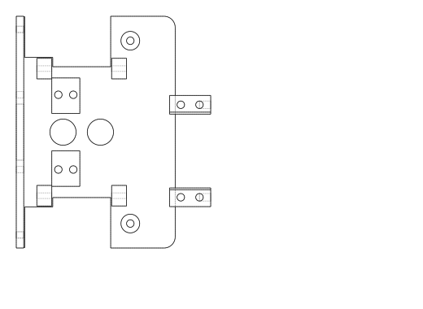 | 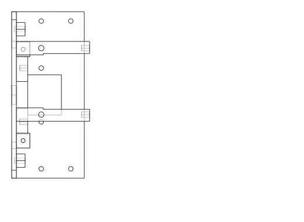 | 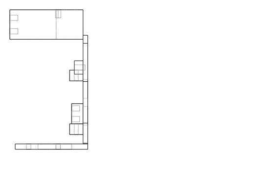 | 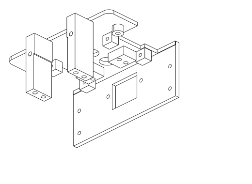 |

| Feature | Dimension |
|---|---|
| Hinge blocks | X 130.0/170.0 ± 4, Y ±34.0, pin Z 26.5, Ø3.0 |
| Bellcrank posts | Ø10 at X 176.0, Y ±48.9, M3 insert |
| Servo pillars | tab faces Z 76; inserts 49.5 x 10 pattern; case pocket 41.5 x 23 |
| Tub flange bolts | 6x Ø3.4 (Y ±55/±20 @ Z 40, ±55 @ Z 62) |
| Tower pads | 4x M3 inserts at X 137.5/145.5, Y ±20 |

## DWG-24 — 24_FRONT_SHOCK_TOWER

Material: **PA-CF**. Print data: see `bom/print_list.csv`. STEP: `out/step/parts/`.

| Top | Front | Side | Iso |
|---|---|---|---|
|  | 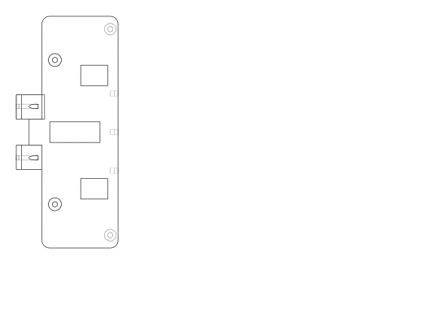 | 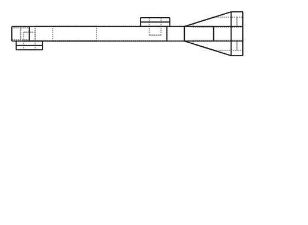 | 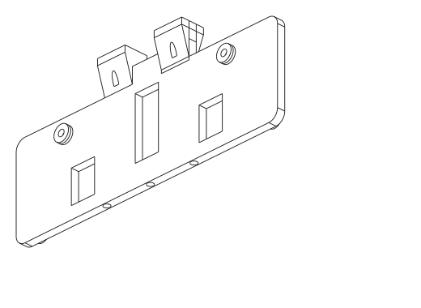 |

| Feature | Dimension |
|---|---|
| Plate | X 139.0–144.0, Y ±90, top Z 109.0 |
| Shock top | insert on rear face at Y ±80.0, Z 103.0; ball 12 mm behind face |
| Camber link | insert on front face at Y ±56.0, Z 60.0 |
| Mast inserts | 3x M3 on top edge at Y −30/0/30 |

## DWG-10 — 10_MAIN_CHASSIS (tub)

Material: **PETG-CF**. Print data: see `bom/print_list.csv`. STEP: `out/step/parts/`.

| Top | Front | Side | Iso |
|---|---|---|---|
| 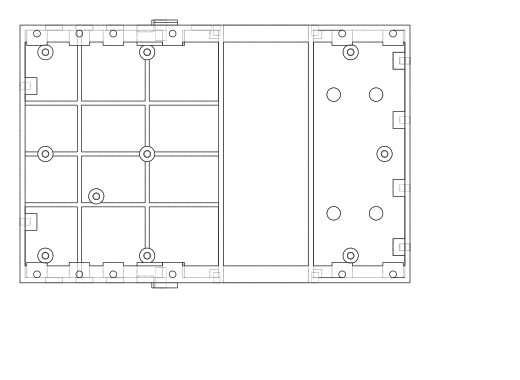 | 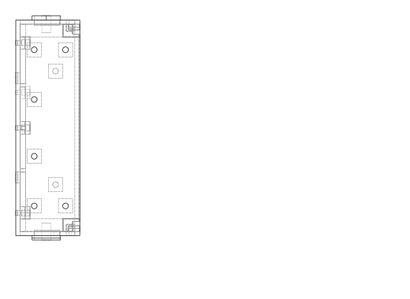 | 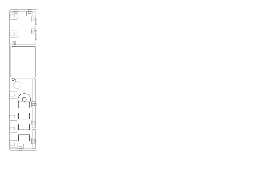 | 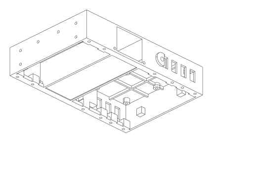 |

| Feature | Dimension |
|---|---|
| Envelope | 230.0 x 152.0 x 55.0 mm, floor 3.0, walls 3.0 |
| Battery tunnel | X 5.0–55.0, Z 30–68.5, through both walls |
| Rail stations | X -105, -80, -60, -25, 75, 105 at Y ±71.0, M3 insert 8 deep |
| Rear-arm pivots | M5 insert, X -32.0, Z 48.5, boss Ø20 |
| Floor bosses | (-100,60); (-100,-60); (-40,60); (-40,-60); (-100,0); (-40,0); (-70,-25); (80,60); (80,-60); (100,0) |

## DWG-12 — 12_UPPER_ELECTRONICS_DECK (ARV 20 mm grid)

Material: **PETG**. Print data: see `bom/print_list.csv`. STEP: `out/step/parts/`.

| Top | Front | Side | Iso |
|---|---|---|---|
| 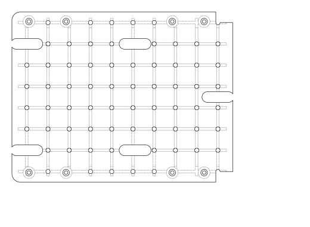 |  |  | 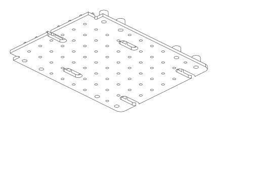 |

| Feature | Dimension |
|---|---|
| Plate | 208.0 x 160.0 x 4.0, ribs 6 mm on 20 mm grid |
| Grid | X −62…118 step 20, Y −70…70 step 20, M3 inserts 7 deep at nodes |
| Rail stand-offs | X -60, -25, 75, 105, Y ±71.0, Ø11 x 10, c'bore Ø6.2 |

## DWG-110-RAIL — Aluminium longeron drilling (2 off)

| Feature | Dimension |
|---|---|
| Stock | 6063 10x10x1 square tube, length 238 ±0.5 (X -120 → 118) |
| Holes | Ø3.4 through both walls (vertical) at X = -105, -80, -60, -25, 75, 105 → from rear end: 15, 40, 60, 95, 195, 225 mm |
| Tolerance | hole position ±0.3; drill with a printed jig (use the tub as the jig) |
